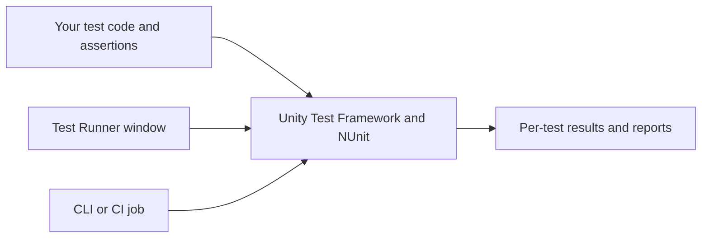

# Unity testing for new developers

Build confidence in a Unity game by checking small rules frequently, checking connected systems when they change, and playing the game to judge the experience. Run repeatable checks on your own machine and keep their detailed reports in files. When working with an AI assistant, send a compact result and the relevant failures so the conversation stays focused.

This onboarding guide explains the tools and a practical workflow for a new Unity project. Railroad Tycoon provides examples and lessons; its operational commands and human acceptance checks remain in the project Testing Guide. AGENTS.md owns agent permissions, and the Editor README owns the test inventory. This guide adds no standing permission to run tests or change project setup.

Read sections 1–5 to get started, sections 6–8 for local execution and AI collaboration, and sections 9–11 when growing your suite.

## 1. What a test actually does

An automated test supplies an input, performs an action, and compares the result with an expected outcome. An **assertion** is that comparison expressed in code. For example: “With $100 available, trying to spend $101 fails and leaves the balance at $100.” A useful test identifies the broken rule when it fails.

Organize a test as **Arrange → Act → Assert**:

1. Arrange the smallest starting state needed for the behavior.
2. Act through the production API that a real caller uses.
3. Assert the observable outcome, including relevant side effects or preserved state.

Use a known expected result. Calculating the expectation with a copy of the production algorithm can reproduce the same bug on both sides. Likewise, a test that only confirms “no exception was thrown” says little about whether the player received the correct result.

## 2. The different types of tests

These names answer different questions. A unit test can also be a regression test, run in EditMode, and belong to a smoke suite.

| Type | Question it answers | Example from a railroad game |
|---|---|---|
| Unit | Does one small rule behave correctly with little setup? | Reject an invalid wagon count without changing the schedule |
| Integration | Do several real parts cooperate correctly? | Purchasing a station debits money and registers the station |
| End to end or journey | Can a representative feature flow complete? | Start a world, build a route, buy a train, and earn delivery income |
| Regression | Does previously working behavior still work? | A train resumes after a formerly deadlocking depot wait |
| Smoke | Does a short selection show that the essentials work? | Boot the game and complete one basic purchase |
| Scene or asset validation | Is authored content configured correctly? | A saved gameplay scene assigns required bootstrap references |
| Performance | Does measured cost meet a defined budget? | Train updates meet a CPU budget on the target machine |
| Visual or UI | Does presentation meet a measurable or reviewed expectation? | A panel fits its supported viewport and text remains readable |
| Manual playtest | Does the experience work for a person? | Controls feel clear and a train looks correct on a slope |

“Regression” describes why a test is retained; it does not imply a large or slow test. “Smoke” describes a selected suite, not a special Unity execution mode.

Start with many inexpensive rule checks, fewer integration checks, and a small number of journeys. Treat this as a practical balance rather than a required percentage. Prioritize costly mistakes, especially money, saves, state transitions, and construction validation. Visual quality and game balance still need human judgment.

## 3. Where Unity Test Framework and Test Runner fit

**Unity Test Framework (UTF)** is the `com.unity.test-framework` package. It integrates NUnit with Unity execution. **NUnit** supplies test attributes, assertions, and fixture setup/cleanup; Unity adds support for frames and Editor-specific behavior. **Test Runner** is the Editor window used to discover, select, run, and inspect tests. Command-line execution uses the same testing system. [Unity testing introduction](https://docs.unity.com/en-us/engine/6000.6/manual/programming-environment/test-framework-introduction)



The runner executes the tests you wrote. You supply the acceptance criteria and decide which behaviors need coverage. Running a test from a terminal changes how it is launched, not how thoroughly its assertions check the game.

### EditMode, PlayMode, and a built player

| Execution environment | Good starting uses | What needs additional evidence |
|---|---|---|
| EditMode | Rules, geometry, configuration, explicitly stepped simulations, Editor tools | Runtime lifecycle and player platform behavior |
| PlayMode in the Editor | Runtime lifecycle, interactions across frames, runtime UI and physics | The shipped build on target hardware |
| Tests in a built player | Platform and runtime behavior outside the Editor | The complete shipped experience and human usability |

EditMode and PlayMode describe **execution environments**. They are separate from unit/integration scope. PlayMode can execute inside the Editor or on a target player; an Editor PlayMode run does not establish build-specific behavior. Player test builds are separate from ordinary release builds. [EditMode and PlayMode](https://docs.unity.com/en-us/engine/6000.6/manual/programming-environment/test-framework-introduction/getting-started/edit-mode-vs-play-mode-tests), [player testing](https://docs.unity.com/en-us/engine/6000.6/manual/programming-environment/test-framework-introduction/running-tests/workflow-run-playmode-test-standalone)

Railroad Tycoon runs substantial multi-train simulations in EditMode by advancing the simulation explicitly. A small check of a component's actual runtime lifecycle might instead need PlayMode.

EditMode does not promise a non-disruptive run. Fixtures can open scenes or windows, and the installed runner can prepare or replace the active scene before fixtures execute. Scene restoration afterwards does not preserve uninterrupted work during the run. Use an isolated project checkout for disruptive automation.

## 4. Set up a new project

1. Choose an appropriate Editor version and keep it consistent across developers and CI. Check `ProjectSettings/ProjectVersion.txt`.
2. Inspect Package Manager for Test Framework and use a compatible version. Commit the project's package manifest and lock file so teammates resolve the same dependencies.
3. Open **Window → General → Test Runner** and create an EditMode test assembly. Add a PlayMode assembly when a behavior needs runtime execution. The creation controls vary with Unity version. [Create a test assembly](https://docs.unity.com/en-us/engine/6000.6/manual/programming-environment/test-framework-introduction/getting-started/workflow-create-test-assembly)
4. Check assembly references. A test assembly should reference the production assembly it exercises and have test-framework references. Keep Editor-only dependencies out of runtime assemblies.
5. Add one meaningful test. In Test Runner's EditMode tab, select it and choose **Run Selected**, then inspect its individual result. During development, temporarily make the expectation wrong, confirm that the test fails, then restore it. This checks discovery and that the assertion matters.
6. Verify an ordinary player build as well as test execution before relying on the setup. NUnit and Editor-only dependencies should stay outside the normal shipped player.

An **assembly definition** (`.asmdef`) gives scripts an explicit compiled assembly and dependency boundary. It is a common choice for new-project test assemblies. However, a custom asmdef cannot reference Unity's predefined `Assembly-CSharp`. Creating only a test asmdef can leave tests unable to access gameplay still in that predefined assembly. Plan production and test references together. An `Editor` folder nested under a runtime asmdef does not automatically become a separate Editor assembly. [Assembly reference limitations](https://docs.unity3d.com/6000.0/Documentation/Manual/assembly-definitions-referencing.html), [assembly definitions](https://docs.unity3d.com/6000.0/Documentation/Manual/assembly-definitions.html)

**Railroad Tycoon deliberately uses an existing alternative:** gameplay/Core remain in `Assembly-CSharp`, with Editor tests under `Assets/Editor/Tests/` in the predefined Editor assembly. Follow the existing assembly decision here. For a new project, choose its layout deliberately; this onboarding guide does not call for migrating the current project.

## 5. Read and write a small test

This illustrative extract uses Railroad Tycoon's actual date-clamping API. It fits inside a configured EditMode test file; the API itself belongs to this project.

```csharp
using System;
using NUnit.Framework;
using StrategyCore;

public class CalendarTests
{
    [Test]
    public void InvalidFebruaryDayClampsToLastDayOfMonth()
    {
        // Arrange: 1900 is not a leap year.
        var expected = new DateTime(1900, 2, 28);

        // Act: callers can supply an out-of-range day.
        var actual = SimulationSession.ClampDate(1900, 2, 31);

        // Assert: return the nearest valid date.
        Assert.That(actual, Is.EqualTo(expected));
    }
}
```

The existing calendar tests use `[TestCase]` for several inputs with the same contract, including leap years. Parameterized cases are useful for boundaries: zero, one below a limit, the limit, one above it, and invalid inputs covered by the API's contract.

Use `[Test]` for synchronous checks. Use `[UnityTest]` with an `IEnumerator` when execution must yield, for example while waiting for a frame or an Editor repaint. A UnityTest can run in either test environment. Prefer a meaningful completion condition with a deadline over a long arbitrary wait. [UnityTest attribute](https://docs.unity3d.com/Packages/com.unity.test-framework@1.4/manual/reference-attribute-unitytest.html)

A **fixture** is the test class and its shared setup. `[SetUp]` prepares each test; `[TearDown]` cleans up after it. Destroy temporary GameObjects and ScriptableObjects, unsubscribe handlers, restore modified globals, and remove temporary files. Cleanup must work when an assertion fails. The economy-rate tests show a short in-memory asset fixture. [NUnit SetUp](https://docs.nunit.org/articles/nunit/writing-tests/attributes/setup.html), [NUnit TearDown](https://docs.nunit.org/articles/nunit/writing-tests/attributes/teardown.html)

Assert one behavior per test, with multiple assertions when they describe that behavior. For a rejected purchase, checking rejection and the unchanged balance is useful. Tests should pass independently and in a different order. A **flaky test** changes its result without a relevant code change; shared leftover state, uncontrolled time, and randomness are common causes.

UTF normally fails tests on unexpected error, exception, or assertion logs. If a negative case deliberately produces an error, declare the exact expected message with `LogAssert.Expect` before the action. A missing expected message also fails. Broadly ignoring failing messages hides useful evidence. [LogAssert API](https://docs.unity3d.com/Packages/com.unity.test-framework@1.4/api/UnityEngine.TestTools.LogAssert.html)

## 6. Run tests locally with Unity CLI

There are three distinct entry points:

| Entry point | What it controls | Requirement |
|---|---|---|
| `unity test ...` | Starts an Editor in batch mode and runs UTF | Unity CLI, installed/licensed Editor, and the project's Test Framework |
| `unity command ...` | Requests commands from a connected Editor | Unity CLI and a compatible Pipeline package exposing those commands |
| Editor executable with `-runTests` | Invokes UTF directly | Editor and Test Framework; the CLI wrapper is optional |

The CLI verified for these examples was **1.0.0-beta.13**. Check installed help before adopting commands on another machine; the [official CLI reference](https://docs.unity.com/en-us/unity-cli/unity-cli-reference) identifies local help as authoritative for supported commands.

```bash
unity --version
unity test --help
```

### A new project with its Editor closed

Use your project's actual absolute path and an existing results directory. These shell examples are for macOS/Linux; adapt path syntax for your platform.

```bash
mkdir -p /absolute/path/to/results

# Start with one fixture. Replace the example namespace and class.
unity test /absolute/path/to/MyGame --mode EditMode \
  --filter "MyGame.Tests.CalendarTests" \
  --output /absolute/path/to/results/calendar.xml --timeout 600

# Forward a category to UTF; there is no top-level --category option.
unity test /absolute/path/to/MyGame --mode EditMode \
  --output /absolute/path/to/results/unit.xml --timeout 600 \
  -- -testCategory Unit

# Run a separate runtime batch when relevant.
unity test /absolute/path/to/MyGame --mode PlayMode \
  --output /absolute/path/to/results/playmode.xml --timeout 600
```

`Unit` is a category you assign with `[Category("Unit")]`; UTF does not supply a universal Unit suite. `--filter` selects names. Check the report's actual selection and executed counts, since matching zero tests establishes no behavior. UTF owns forwarded [test-filtering arguments](https://docs.unity.com/en-us/engine/6000.6/manual/programming-environment/test-framework-introduction/reference-command-line).

Batch execution loads Unity and may compile or import assets. Run against a closed project or a separate checkout: concurrent Editors should not share one project directory and Library. A hidden Editor still uses CPU and memory.

For machines without Unity CLI, a direct Editor command is:

```bash
"/absolute/path/to/Unity" -batchmode \
  -projectPath /absolute/path/to/MyGame \
  -runTests -testPlatform EditMode \
  -testFilter "MyGame.Tests.CalendarTests" \
  -testResults /absolute/path/to/results/calendar.xml \
  -logFile /absolute/path/to/results/editor.log
```

Let `-runTests` finish and write results; adding `-quit` can terminate execution prematurely. Avoid `-nographics` for checks that need rendering. Keep direct Editor exit-code handling separate from the CLI wrapper's contract. [UTF command-line reference](https://docs.unity.com/en-us/engine/6000.6/manual/programming-environment/test-framework-introduction/reference-command-line)

Editor PlayMode testing is what `unity test --mode PlayMode` requests. Built-player testing is a separate route through the Test Runner's player controls or UTF's supported BuildTarget selection. The installed CLI's `--mode` help lists EditMode and PlayMode; do not substitute a build target there.

### Railroad Tycoon with its Editor open

For an authorized headless run, use the existing wrapper from the repository root, choosing the category or fixture needed:

```bash
Tools/test-headless.sh Unit
Tools/test-headless.sh RailroadTycoon.EditorChecks.Tests.SimulationSessionQueryTests
```

The wrapper maintains a separate project mirror, synchronizes working-copy changes including uncommitted edits, runs `unity test`, and prints counts plus failures. Full NUnit XML and the Editor log stay under `Logs/TestResults/`. Each batch must finish before another uses the mirror. See the operational guide for category-specific restrictions.

Its initial clone uses macOS copy-on-write (`cp -cR`). Reuse the isolation pattern on other platforms with a suitable copy/worktree strategy. The script's default mirror is **`<repository-path>.testmirror`**; `RAILROAD_TEST_MIRROR` overrides it. Sync and locking behavior belong to the script.

Discover live Editor commands before using them:

```bash
unity status
unity command --help
unity command --query run_tests --detail full --format json
```

Pipeline's live runner options are separate from `unity test` options. Inspect the connected Editor's command schema, select the correct project when multiple Editors are open, and check execution effects. Our live runner can replace the active scene even for Unit tests. Cancel a dirty-scene prompt and the pending request to preserve unsaved work rather than letting an agent decide whether to save or discard it.

## 7. Save AI tokens with local execution

Local testing and model token consumption are separate concerns. Unity compiles, simulates, and evaluates assertions on your machine. Model tokens are spent when an assistant reasons or reads tool output. A local run still consumes conversation tokens if you stream complete logs into chat. The useful optimization is **local execution plus local summarization plus focused diagnosis**. No fixed percentage saving is implied.

### The daily loop

1. Define the behavior before changing code. Choose the smallest existing test or fixture that can reveal a mistake.
2. Make the change and let Unity finish compiling. A compile failure prevents a useful test verdict.
3. Run the focused test locally, yourself or through an authorized runner. Keep XML/JSON and the complete log in files.
4. Summarize the report with a script: passed, failed, skipped, duration, and each failure's full name, first useful message, and source location. Record the exact command/filter, revision or uncommitted state, and artifact paths.
5. Give the assistant that compact evidence. Expand the failing record or log only when needed for diagnosis.
6. After a fix, rerun the failing test and then the relevant surrounding suite. Validate the final revision with the agreed broader checks before merging. A narrow passing rerun does not replace the original suite.

An example handoff, with illustrative counts:

```text
Revision: <commit SHA> + uncommitted changes in TrainScheduleDraft.cs
Run: <exact command and filter>
Outcome: completed; 42 passed / 1 failed / 2 skipped; <duration>
Failure: <full test name> — expected rejection, received success
Location: Assets/Editor/Tests/Trains/ScheduleWagonCountTests.cs:<line>
Report: <absolute path to fresh XML>
Editor log: <absolute path>
Request: diagnose this failure; inspect its full record if needed.
```

Include a seed, simulation step size, platform, or case arguments when they affect reproduction. If execution failed before producing XML, send the first actionable error and a short relevant log excerpt.

| Keep locally or in CI artifacts | Send to the assistant |
|---|---|
| Full Editor log and per-test XML/JSON | Counts, scope, revision, outcome, duration, artifact paths |
| Passing-test names and long simulation traces | Failing names, useful messages, and source locations |
| Complete screenshots or performance captures | Relevant evidence when appearance or timing is the question |
| Repeated polling output | Completion, timeout, or a meaningful change needing attention |

Use a deterministic script to extract results instead of asking the model to summarize thousands of lines repeatedly. Railroad Tycoon's mirror wrapper already does this. For a new project, add a small equivalent parser around the chosen report format and preserve its exit code and execution-error reporting. The summary is an index into full evidence, so keep that evidence available.

Avoid loading the entire test inventory or this guide into every implementation prompt. Link the relevant section or identify a fixture. Choose scope from behavior and dependencies, including assets and scene wiring. A feature's tests are not necessarily named after its changed source file.

A dedicated runner agent can isolate execution details. Give it an explicit scope, route, and reporting contract. Our runner instructions return counts and failures while detailed reports stay outside the parent conversation. Delegation also uses tokens; it complements deterministic summarization and is especially useful for runner setup and troubleshooting. This repository requires that delegation for authorized agent-run batches.

For a new project, agree which fast suites agents may run, whether they may open scenes or enter PlayMode, and when broader validation happens. Here those choices already belong to AGENTS.md, including its issue and PR exceptions. A hidden Editor preserves the workspace but does not expand authorized scope.

## 8. Decide whether a run actually passed

Read fresh per-test results. Archive previous reports separately, or remove the intended output before a new run, so a failed launch cannot leave an old green report looking current.

| Outcome | Meaning and next action |
|---|---|
| Intended tests executed with no failures | Evidence for this selection on this revision; inspect skipped cases too |
| Failed assertion or unexpected error log | Inspect the message and trace; determine whether code, test, or environment is wrong |
| Compile error, timeout, crash, missing license, or no fresh report | Execution is incomplete or blocked; there is no passing verdict |
| Zero tests selected | Check discovery, filters, categories, and explicit-test selection |
| Skipped, ignored, unselected explicit, or inconclusive | That behavior was not established by this run |
| Passes only on retry | Investigate possible flakiness and preserve the original failure |

The verified `unity test` wrapper uses exit **0** for success and **8** for completed runs with failing tests. Other errors require diagnosis. Check the fresh report's selection and outcomes even with exit 0. These numbers are the CLI wrapper's contract, not a universal contract for every runner or direct Editor invocation.

`[Explicit]` tests need deliberate selection; a category run can leave them unexecuted. In this project, select Journey and Expensive checks by the full names in the Testing Guide. A large green total does not compensate for a missing acceptance check.

When results look stale after a script reload, let the Editor settle and verify its status before retrying once. Diagnose repeated problems rather than polling indefinitely. Preserve unexpected failures; broad log suppression, weakened assertions, and retrying until green reduce the value of testing.

## 9. Design code that is practical to test

Railroad Tycoon's reusable lesson is to give each rule one owner and make inputs explicit. The session owns money changes, so callers ask it to spend. Tests can check rejection, preserved balance, and notifications at that boundary without recreating the world.

- **Separate rules from presentation.** Let a small API decide affordability or schedule validity; let MonoBehaviours and UI adapt it to the scene. Keep scene dependencies at the composition boundary.
- **Inject dependencies explicitly.** A test can provide a small controlled dependency set. Retain integration checks for the actual bootstrap wiring.
- **Control time and randomness.** Fixed seeds and explicit simulation steps make failures repeatable. Record both. Add meaningful step-size and update-order variations; one fixed run cannot establish behavior under every frame rate.
- **Prefer lightweight real objects.** A fake substitutes a dependency with controlled behavior and can isolate a rule. Excessive mocks can check imagined interactions while missing whether real systems cooperate.
- **Keep fixtures small and honest.** Flat disposable tracks can expose routing bugs. Authored terrain, actual models, and player input need additional evidence.
- **Check saved content too.** A valid class cannot guarantee that a scene assigned its required references. Scene/asset checks address this separate failure mode.

Use floating-point tolerances with a stated reason. Define a budget, measurement environment, and warmup policy before treating performance timings as pass/fail. Code coverage shows which code executed, not whether assertions establish its important outcomes. Use it to find gaps worth investigating. These practices favor observable behavior and repeatable checks. [Microsoft unit testing best practices](https://learn.microsoft.com/en-us/dotnet/core/testing/unit-testing-best-practices)

## 10. Grow from local checks to CI

**Continuous integration (CI)** runs agreed checks automatically when code is pushed or a PR changes. Start with commands and reports that work locally, using a consistent Editor, package set, platform, and licensed environment. Publish XML and logs as artifacts and make failures visible to reviewers.

| Stage | Suggested scope for a new project |
|---|---|
| During an edit | Fast rule tests and the relevant fixture |
| Before a commit or PR | Fast suite plus integrations affected by the change |
| PR validation | Agreed integration/content checks and relevant player compilation/runtime checks |
| Scheduled or release validation | Longer scenarios, platform runs, performance/visual review, and human acceptance |

A clean CI checkout helps reveal hidden dependencies on local assets or settings. Local runs shorten feedback; CI verifies the shared revision independently. Cache imports where appropriate, but identify reports by revision and run. Keep concurrent runners' writable project/Library directories separate.

## 11. A practical starting plan

Begin a new game with one meaningful rule test, one integration test for a critical flow, a repeatable local command, and a short human playtest checklist. Add a regression case when a bug exposes a lasting risk. Maintain the smallest suite that provides useful confidence; trivial implementation assertions that break during harmless refactoring add maintenance work.

Borrow Railroad Tycoon's explicit ownership, controlled simulations, fixture cleanup, workspace isolation, and compact result reporting. Its category names, mirror implementation, and single headless Journey arrangement are project choices, not Unity requirements. Keep rules in one place and runner instructions short enough to use consistently.

## Sources and version context

Reviewed on **21 October 2026**, against project Unity **6000.7.0b4**, Test Framework **1.9.0**, Pipeline **0.7.0-exp.1**, and installed Unity CLI **1.0.0-beta.13**. Public Unity sources above include the 6000.6 manual and versioned UTF API pages. Use documentation and command schemas matching the installed version for exact support. Project versions remain owned by `ProjectVersion.txt`, the package manifest, and the resolved lock file.

- [Unity testing introduction](https://docs.unity.com/en-us/engine/6000.6/manual/programming-environment/test-framework-introduction) — framework concepts and documentation entry point.
- [Unity CLI reference](https://docs.unity.com/en-us/unity-cli/unity-cli-reference) and local `unity test --help` — wrapper commands and supported options.
- [UTF command-line reference](https://docs.unity.com/en-us/engine/6000.6/manual/programming-environment/test-framework-introduction/reference-command-line) — direct Editor arguments and filtering.
- [NUnit documentation](https://docs.nunit.org/articles/nunit/intro.html) — attributes and assertions; use APIs supported by the NUnit bundled with the installed UTF.
- Project Testing Guide, test inventory, mirror runner, and agent runner — operational procedures and examples.